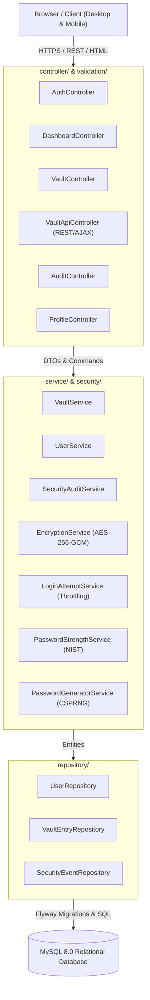
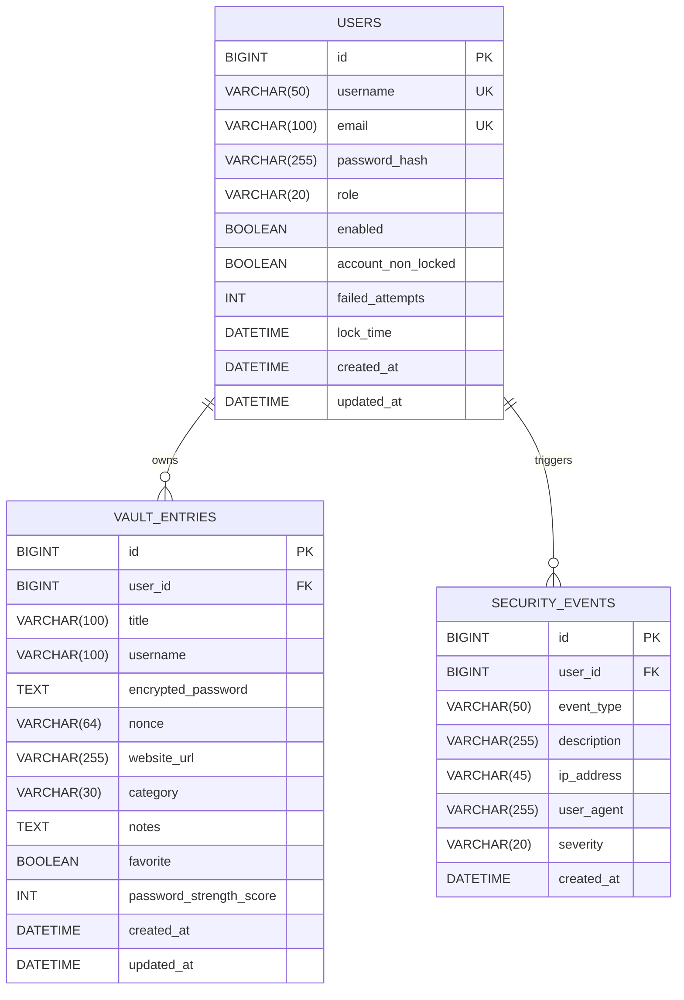

# 🛡️ SecureVault — Enterprise-Grade Cybersecurity Password Manager

[](https://openjdk.org/projects/jdk/21/)
[](https://spring.io/projects/spring-boot)
[](https://csrc.nist.gov/publications/detail/sp/800-38d/final)
[](https://en.wikipedia.org/wiki/Authenticated_encryption)
[](https://www.mysql.com/)
[](LICENSE)

> A modern, zero-knowledge password management web application engineered to demonstrate advanced Java 21 software craftsmanship, layered defense architecture, relational database engineering, and applied cybersecurity principles.

---

## 📋 Table of Contents

1. [Overview & Vision](#1-overview--vision)
2. [Key Features](#2-key-features)
3. [Interface & Design Preview](#3-interface--design-preview)
4. [Technology Stack](#4-technology-stack)
5. [System & Layered Architecture](#5-system--layered-architecture)
6. [Database Schema & ER Model](#6-database-schema--er-model)
7. [Cryptographic Architecture & Security Controls](#7-cryptographic-architecture--security-controls)
   - [AES-256-GCM Authenticated Encryption](#aes-256-gcm-authenticated-encryption)
   - [Nonce Management & Unique IV Invariants](#nonce-management--unique-iv-invariants)
   - [Hashing vs. Reversible Encryption](#hashing-vs-reversible-encryption)
   - [Envelope Encryption & Key Management](#envelope-encryption--key-management)
   - [Brute-Force & Lockout Defenses](#brute-force--lockout-defenses)
   - [IDOR & Ownership Controls](#idor--ownership-controls)
   - [Defense in Depth (CSP, CSRF, Session Fixation)](#defense-in-depth)
8. [Prerequisites](#8-prerequisites)
9. [Installation & Local Setup](#9-installation--local-setup)
10. [Configuration & Environment Variables](#10-configuration--environment-variables)
11. [Build, Test, and Execution](#11-build-test-and-execution)
12. [Local Verification Checklist](#12-local-verification-checklist)
13. [Limitations & Production Roadmap](#13-limitations--production-roadmap)
14. [Contributing & Code of Conduct](#14-contributing--code-of-conduct)
15. [License](#15-license)

---

## 1. Overview & Vision

**SecureVault** is an enterprise-grade password management solution designed for individuals and organizations demanding strict cryptographic assurances for their sensitive credentials. Developed as a flagship portfolio piece for Computer Science and Cybersecurity Engineers, it bridges real-world enterprise web engineering with rigorous defense-in-depth application security.

Unlike naive vault implementations that store credentials in plaintext or employ deprecated symmetric modes (such as AES-ECB or AES-CBC without MAC), SecureVault implements **Authenticated Encryption with Associated Data (AEAD)** via **AES-256-GCM**, strictly enforces **Insecure Direct Object Reference (IDOR)** prevention across every endpoint, provides comprehensive security event audit logging, and incorporates NIST SP 800-63B password heuristics.

---

## 2. Key Features

### 🔐 Password Vault & Secret Management
- **AES-256-GCM Encryption:** Every stored secret is encrypted with a unique 96-bit cryptographically secure pseudorandom nonce (IV) and protected by a 128-bit authentication tag.
- **Categorization & Tagging:** Organize items into Logins, Credit Cards, Secure Notes, API Keys, Server/SSH Keys, and Identities.
- **Full-Text Vault Search & Filtering:** Filter seamlessly by title, username, target URL, and favorites.
- **On-Demand Password Revelation:** Decryption only occurs upon explicit authorized user action via AJAX; secrets automatically re-mask after 25 seconds to minimize shoulder-surfing risks.
- **One-Click Clipboard Integration:** Securely copy usernames or secrets with immediate visual feedback.
- **Cryptographic Password Generator:** Generate configurable, high-entropy secrets (length 8–64, customizable character classes, ambiguous character filtering).
- **Secure Data Export:** Export personal vault data in structured JSON or CSV format, with sensitive password fields strictly excluded by default unless explicit opt-in confirmation is granted.

### 🛡️ Authentication & Account Defense
- **Zero Plaintext Credentials:** Master passwords hashed with BCrypt (cost factor 12) or Argon2id with per-user cryptographic salts.
- **Brute-Force Throttling & Account Lockout:** Progressive failure tracking locks accounts for 15 minutes after 5 consecutive failed attempts.
- **Generic Authentication Responses:** Constant-time and generic failure notifications prevent username enumeration attacks.
- **Session Fixation Shield:** Automatic session migration upon successful privilege change.
- **Session Cookie Hardening:** `HttpOnly`, `SameSite=Lax`, custom cookie naming, and configurable `Secure` flags.

### 📊 Security Dashboard & Audit Trail
- **Holistic Vault Hygiene Score:** Instant calculation of personal security score (0–100%) based on password strength, entropy, and reuse.
- **Password Strength Distribution:** Visual breakdown of vault strength against NIST complexity metrics.
- **Safe Password Reuse Detection:** In-memory, authorized-only detection of repeated credentials across multiple accounts without leaking plaintext to disk or external APIs.
- **Comprehensive Security Audit Trail:** Immutable logging of all sensitive events (logins, failed attempts, lockouts, entry creations, updates, deletions, and password reveals) with client IP and User-Agent metadata.
- **Automatic Log Retention Policy:** Configurable retention periods for audit compliance.

---

## 3. Interface & Design Preview

SecureVault features a custom-built, modern dark SaaS aesthetic with deep charcoal foundations (`#090d16`), electric cyan accents (`#38bdf8`), subtle border glows, responsive sidebars, and accessible form controls.

```
+-----------------------------------------------------------------------------------+
|  [🛡️ SecureVault]                                    Logged in: analyst@corp.com  |
+-------------------+---------------------------------------------------------------+
|                   |  SECURITY DASHBOARD                                           |
|  [⊞] Dashboard    |  +---------------+ +---------------+ +---------------+        |
|  [🔒] Vault Items |  | Total Secrets | | Health Score  | | Weak Passwords|        |
|  [📋] Audit Logs  |  |      24       | |     92%       | |       1       |        |
|  [⚙️] Profile      |  +---------------+ +---------------+ +---------------+        |
|                   |                                                               |
|  -- TOOLS --      |  PASSWORD STRENGTH DISTRIBUTION (NIST SP 800-63B)             |
|  [⚡] Generator   |  Very Strong [████████████████████░░░░░░] 65%                 |
|                   |  Strong      [████████░░░░░░░░░░░░░░░░░░] 25%                 |
|                   |  Fair        [███░░░░░░░░░░░░░░░░░░░░░░░] 10%                 |
|                   |                                                               |
|  [🚪] Sign Out    |  RECENT VAULT CREDENTIALS                                     |
|                   |  Service     Username     Secret        Strength   Actions    |
|                   |  GitHub      dev_ops      ••••••••••••  [Strong]   [👁️] [📋] |
|                   |  AWS Prod    cloud_admin  ••••••••••••  [V.Strong] [👁️] [📋] |
+-------------------+---------------------------------------------------------------+
```

---

## 4. Technology Stack

| Layer | Technology | Version | Purpose |
| :--- | :--- | :--- | :--- |
| **Language** | Java (OpenJDK) | 21 (LTS) | Virtual threads, record types, pattern matching |
| **Framework** | Spring Boot | 3.3.4 | Core enterprise application framework |
| **Security** | Spring Security | 6.x | RBAC, CSRF, Session Fixation, Headers, Auth |
| **Cryptography**| Java Crypto API & Bouncy Castle | 1.78.1 | AES-256-GCM AEAD, Argon2id, CSPRNG |
| **ORM** | Spring Data JPA / Hibernate | 6.x | Normalized relational mapping, parameterized queries |
| **Database** | MySQL | 8.0+ | Production transactional relational database |
| **Testing DB** | H2 Database | 2.x | Fast, isolated in-memory test execution |
| **Migrations** | Flyway | 10.x | Version-controlled, idempotent schema migrations |
| **View Engine**| Thymeleaf | 3.x | Context-aware HTML5 templating with auto-escaping |
| **Frontend** | Bootstrap 5 & Custom CSS | 5.3.3 | Responsive cyber SaaS dark theme |
| **Build Tool** | Apache Maven | 3.9+ | Dependency management, compilation, test runner |
| **Testing** | JUnit 5, Mockito, Spring Test | 5.x | Automated unit, security, and integration testing |

---

## 5. System & Layered Architecture

SecureVault is structured following the clean layered architecture pattern:



### Package Structure
```text
com.securevault/
├── config/        # Spring Security, Web MVC, and Vault properties configuration
├── controller/    # Web MVC controllers and REST endpoints
├── dto/           # Strongly typed Request/Response data transfer objects
├── entity/        # JPA Entities (User, VaultEntry, SecurityEvent, Enums)
├── exception/     # Centralized exception handling & HTTP response codes
├── mapper/        # Entity-to-DTO and DTO-to-Entity transformation mappers
├── repository/    # Spring Data JPA repositories with scoped queries
├── security/      # Cryptographic engine, rate limiting, and auth listeners
├── service/       # Transactional business logic and cryptographic orchestration
└── validation/    # Bean Validation constraint annotations and validators
```

---

## 6. Database Schema & ER Model

Database schemas are strictly managed and migrated using **Flyway** (`db/migration/V1__init_schema.sql`).



---

## 7. Cryptographic Architecture & Security Controls

### AES-256-GCM Authenticated Encryption
SecureVault employs **AES in Galois/Counter Mode (GCM)** with a **256-bit symmetric key**, `AES/GCM/NoPadding`.
- GCM provides both **confidentiality** and **authenticity** (AEAD).
- Every encryption generates an authentication tag of **128 bits**.
- If a single bit of ciphertext or nonce is altered in transit or in the database, the cryptographic engine detects the tampering and immediately throws `javax.crypto.AEADBadTagException`, preventing oracle attacks or corrupted data leakage.

### Nonce Management & Unique IV Invariants
- AES-GCM requires that **a key and initialization vector (IV / Nonce) pair is NEVER reused**. Reusing an IV with the same key destroys Galois authentication guarantees and can leak XOR plaintext.
- SecureVault uses a cryptographically secure pseudo-random number generator (`java.security.SecureRandom`) to generate a unique **96-bit (12-byte) nonce** for every individual encryption.
- Nonces are stored alongside the ciphertext in Base64 encoding.

### Hashing vs. Reversible Encryption

| Criterion | Password Hashing (BCrypt / Argon2id) | Symmetric Encryption (AES-256-GCM) |
| :--- | :--- | :--- |
| **Purpose** | Identity authentication / credential validation | Confidential data retrieval |
| **Reversibility** | **One-way (irreversible).** Plaintext cannot be computed from hash. | **Two-way (reversible).** Plaintext is recovered with master key. |
| **Application** | Master account passwords | Stored vault credentials and secure notes |
| **Design** | Computationally and memory-hard to thwart offline brute-force | Fast, authenticated, hardware-accelerated (AES-NI) |

### Envelope Encryption & Key Management
1. **Master Encryption Key:** Read exclusively from the environment variable `VAULT_MASTER_KEY` (64-character hex string = 256 bits).
2. **Outside Source & Database:** Encryption keys are never committed to version control, compiled into binaries, or stored in database tables.
3. **Argon2id Key Derivation Support:** The cryptographic engine supports deriving secondary or per-user encryption keys from user passphrases using Argon2id ($m=64\text{MB}, t=3, p=1$).

### Brute-Force & Lockout Defenses
- The `LoginAttemptService` monitors consecutive authentication failures per account.
- Upon 5 failed attempts, the account is locked for 15 minutes.
- Audit records capture the failure and lockout events.
- All authentication failures return generic messages ("Invalid username or master password") to prevent username harvesting.

### IDOR & Ownership Controls
Every read, update, reveal, and delete operation on a vault resource enforces strict ownership validation via parameterized queries:
```java
// Strictly scoped query ensures User A cannot access User B's record
Optional<VaultEntry> findByIdAndUserId(Long id, Long userId);
```
Attempts to query or mutate an entry belonging to another user immediately trigger an `UnauthorizedAccessException`, which returns a **403 Forbidden** security alert and logs an audit entry.

### Defense in Depth
- **CSRF Protection:** Synchronizer tokens validated on all mutating requests (POST, PUT, DELETE).
- **Content Security Policy (CSP):** Restricts script, style, and font sources to self and trusted CDNs.
- **Clickjacking Defense:** `X-Frame-Options: SAMEORIGIN` prevents framing.
- **Context-Aware Escaping:** Thymeleaf enforces strict context-aware output encoding to eliminate Cross-Site Scripting (XSS).
- **SQL Injection Defense:** Strict use of Spring Data JPA and Hibernate parameterized queries.

---

## 8. Prerequisites

Ensure your development environment meets the following specifications:

- **Java Development Kit (JDK):** Version 21 or higher.
- **MySQL Server:** Version 8.0 or higher.
- **Apache Maven:** Version 3.9+ (or use the provided Maven wrapper `./mvnw` / `mvnw.cmd`).
- **Git:** Version 2.30+.

---

## 9. Installation & Local Setup

### Step 1: Clone the Repository
```bash
git clone https://github.com/your-username/SecureVault.git
cd SecureVault
```

### Step 2: Configure MySQL Database
Open your MySQL terminal or client (e.g. phpMyAdmin, MySQL Workbench) and execute:
```sql
CREATE DATABASE IF NOT EXISTS securevault_db 
    CHARACTER SET utf8mb4 
    COLLATE utf8mb4_unicode_ci;

-- Optional: Create a dedicated application user
CREATE USER IF NOT EXISTS 'vault_user'@'localhost' IDENTIFIED BY 'StrongVaultPassword!2026';
GRANT ALL PRIVILEGES ON securevault_db.* TO 'vault_user'@'localhost';
FLUSH PRIVILEGES;
```

### Step 3: Configure Environment Variables
Copy the template configuration file:
```bash
# On Linux / macOS:
cp .env.example .env

# On Windows PowerShell:
Copy-Item .env.example .env
```

Generate a cryptographically secure 256-bit hex master key:
```bash
# Linux / macOS:
openssl rand -hex 32

# Windows PowerShell:
-join ((1..32) | ForEach-Object { '{0:x2}' -f (Get-Random -Maximum 256) })
```
Set the generated key in `.env` or as a system environment variable `VAULT_MASTER_KEY`.

---

## 10. Configuration & Environment Variables

| Variable | Default Value | Description |
| :--- | :--- | :--- |
| `SERVER_PORT` | `8080` | Web server listening port |
| `SPRING_DATASOURCE_URL` | `jdbc:mysql://localhost:3306/securevault_db...` | JDBC database connection string |
| `SPRING_DATASOURCE_USERNAME` | `root` | Database username |
| `SPRING_DATASOURCE_PASSWORD` | `""` | Database password |
| `VAULT_MASTER_KEY` | *(Ephemeral in dev)* | 256-bit AES master key (64 hex characters) |
| `VAULT_SECURITY_MAX_FAILED_ATTEMPTS` | `5` | Failed login attempt threshold before lockout |
| `VAULT_SECURITY_LOCKOUT_MINUTES` | `15` | Account lockout duration in minutes |

---

## 11. Build, Test, and Execution

### Run Automated Test Suite
The automated test suite runs out of the box using an isolated, in-memory H2 database.
```bash
# Using Maven Wrapper
./mvnw clean test

# Windows PowerShell
.\mvnw.cmd clean test
```

### Package the Production JAR
```bash
./mvnw clean package -DskipTests
```
The compiled executable JAR will be located at `target/securevault-1.0.0.jar`.

### Start the Application
```bash
# Development mode via Maven
./mvnw spring-boot:run

# Or run the production executable JAR directly
java -jar target/securevault-1.0.0.jar
```
Access the application by navigating to **`http://localhost:8080`** in your browser.

---

## 12. Local Verification Checklist

To verify your installation locally:

- [ ] **Access Web Interface:** Navigate to `http://localhost:8080/login`.
- [ ] **Account Registration:** Click *Create Secure Account*, enter username, email, and master password.
- [ ] **Authentication:** Log in using your credentials.
- [ ] **Dashboard Metrics:** Verify that the Security Dashboard loads showing the Health Index, metrics, and NIST distribution.
- [ ] **Create Vault Item:** Click *Add Credential*, generate a password using the built-in generator, and save.
- [ ] **Reveal Secret:** Click the reveal eye icon on your new entry to view the decrypted secret; verify auto-masking.
- [ ] **Clipboard Copy:** Click the copy button to verify clipboard integration.
- [ ] **Audit Trail:** Navigate to *Security Audit* and verify that creation, login, and reveal events are recorded.
- [ ] **Export Vault:** Navigate to *Vault Credentials* -> *Export Vault* and download a sanitized JSON backup.
- [ ] **Account Lockout:** In an incognito window, attempt 5 consecutive incorrect logins to verify account lockout defense.

---

## 13. Limitations & Production Roadmap

While SecureVault adheres to rigorous security standards, production deployment in high-assurance environments can be further enhanced:

1. **Hardware Security Module (HSM) / KMS:** Integrate with AWS KMS, Google Cloud KMS, or HashiCorp Vault for hardware-backed master key rotation.
2. **Client-Side End-to-End Encryption (E2EE):** Migrate key derivation and AES-GCM encryption to the client browser via the Web Cryptography API (`window.crypto.subtle`), ensuring the application server never sees plaintext passwords in memory.
3. **Multi-Factor Authentication (MFA / WebAuthn):** Add FIDO2 / WebAuthn hardware security keys and TOTP authenticator apps.
4. **Secret Sharing & Team Vaults:** Implement Shamir's Secret Sharing or asymmetric RSA/ECDH key wrapping for team-level credential delegation.

---

## 14. Contributing & Code of Conduct

Contributions, bug reports, and security suggestions are welcome. Please read [CONTRIBUTING.md](CONTRIBUTING.md) and [SECURITY.md](SECURITY.md) before submitting pull requests.

---

## 15. License

This project is open-source software licensed under the [MIT License](LICENSE).
